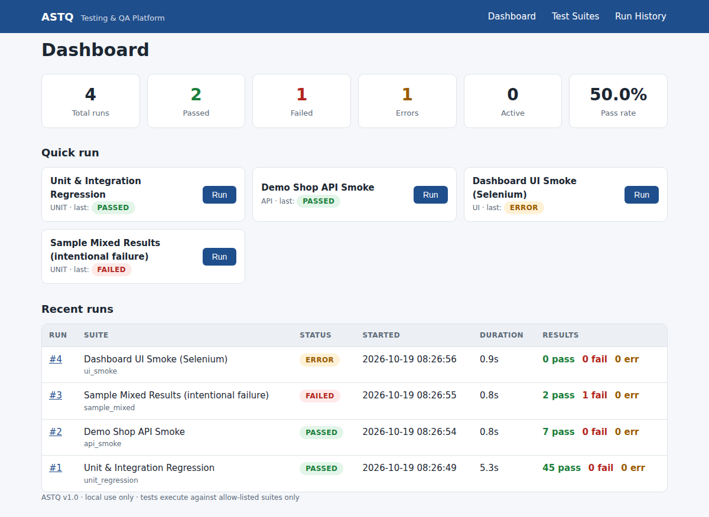
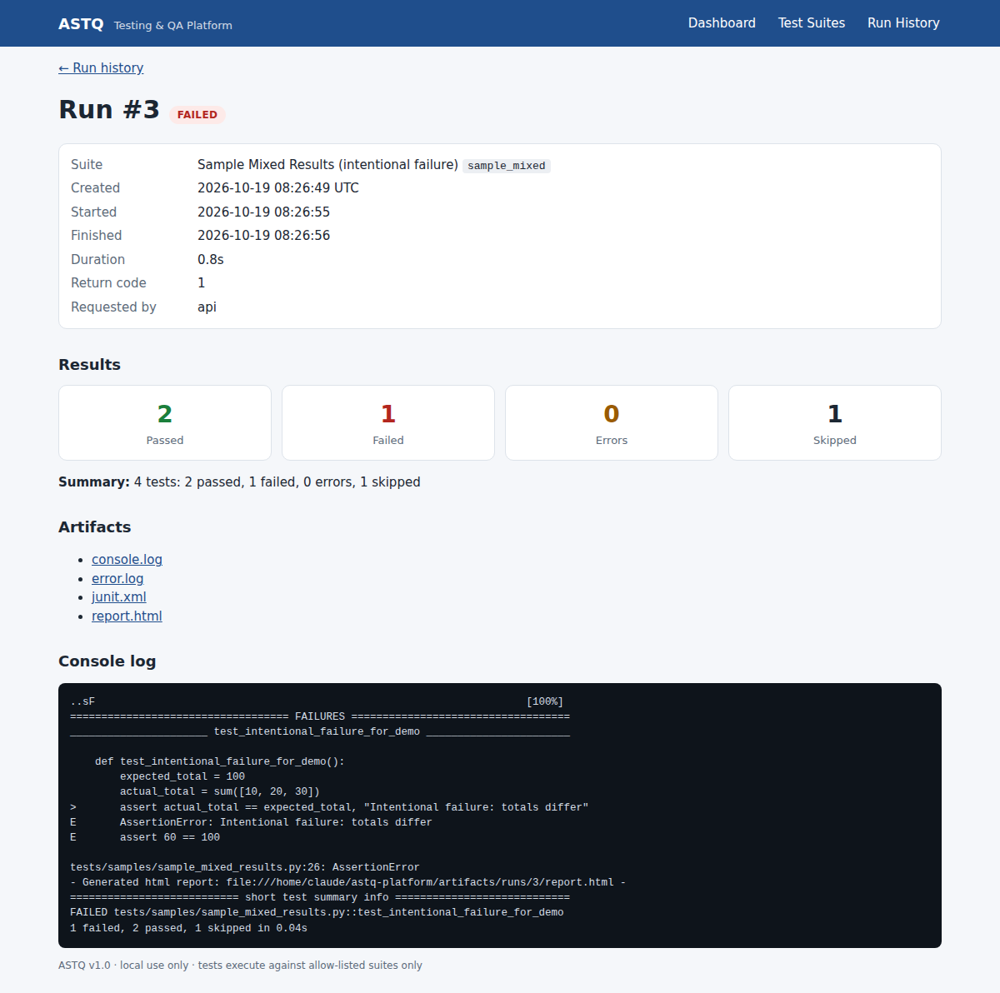

# Abstract

Students usually run unit tests, API checks, browser tests and load tests with different tools in
different terminals, so results are scattered and hard to demonstrate. **ASTQ** is a Flask web
application that gives these activities one home. A user opens a dashboard, chooses an *approved*
test suite, and launches it; ASTQ runs it in a separate, time-limited process, stores the lifecycle
and normalised pass/fail/error/skipped counts in SQLite, keeps logs and reports, and shows history
and details. A REST API exposes the same operations. The platform ships with a controlled demo
e-commerce application as the system under test, 79 automated tests for ASTQ itself (93 % line
coverage), a Selenium page-object suite, a JMeter baseline, and a GitHub Actions pipeline.

# 1. Introduction

## 1.1 Problem statement
Tests are launched with different commands, results vanish in terminal output, and a demonstration
shows execution but not a persistent record (PRD §4). A small, understandable platform is needed that
makes automated testing easy to **run, understand and demonstrate**.

## 1.2 Objectives (PRD §2)
1. One place to discover and launch registered test suites.
2. Persist run history and make outcomes easy to inspect.
3. Integrate UI, API, unit/regression and basic performance testing tools.
4. Demonstrate modular design, REST APIs, automated tests, version control and CI.
5. Keep the first release small enough for a third-year project.

## 1.3 Scope
**In scope:** Flask dashboard, SQLite persistence, suite catalogue, controlled subprocess execution,
Pytest + JUnit parsing, history/detail pages, log/report links, REST endpoints, unit/API tests, CI,
Selenium page objects, optional JMeter baseline.
**Out of scope:** multi-tenant SaaS, distributed grid, arbitrary user-supplied test code, testing of
external targets, roles/enterprise features, production deployment.

# 2. Requirement analysis

## 2.1 Users
Student developer (primary), project teammate (secondary), evaluator/mentor (reviews evidence).

## 2.2 Functional requirements (FR-01 … FR-14)
Implemented as specified in the PRD; the mapping to code and tests is in Chapter 7 and in
`docs/evaluation-guide.md`.

## 2.3 Non-functional requirements
Usability, performance (non-blocking runs), reliability (runner failure cannot crash the app),
security (allow-list, validation, CSRF, no secrets in git, restricted targets), maintainability
(modular monolith), portability, accessibility (semantic HTML, skip link, focus outlines, labelled
controls, status text + colour).

# 3. System design

## 3.1 Architecture
A **modular monolith** with five layers (SDD §5):

| Layer | Package | Responsibility |
|---|---|---|
| Presentation | `app/templates`, `app/static`, `app/routes` | pages and API; routes stay thin |
| Application | `app/services` | validate, create runs, dispatch, finalise status, safe artifact access |
| Execution | `app/execution` | command registry (allow-list), subprocess runner, demo-app launcher |
| Parsing / reporting | `app/parsers`, `app/reporting` | JUnit & JMeter normalisation, dashboard metrics |
| Persistence | `app/models`, SQLite | `TestSuite`, `TestRun` |

## 3.2 Data model
**TestSuite**: `id, suite_key (unique), name, description, suite_type (UI/API/PERFORMANCE/UNIT), enabled, created_at, updated_at`.

**TestRun**: `id, suite_id (FK), status, requested_by, created_at, started_at, finished_at, duration_seconds, return_code, passed/failed/error/skipped counts, summary, error_kind, log_path, report_path`.
One suite has many runs. Artifact paths are stored **relative** to the artifact root; the browser
only receives URLs, never filesystem paths.

## 3.3 Execution workflow (SDD §9)
1. User/API requests a `suite_key`.
2. The route validates the request and calls `run_service`.
3. A `QUEUED` row is committed **before** anything runs.
4. A worker thread marks it `RUNNING`.
5. The runner executes the allow-listed argument list with a timeout; stdout/stderr go to files in `artifacts/runs/<id>/`.
6. The parser normalises the counts.
7. The status rules below are applied and the terminal state is committed (guarded by a last-resort exception handler).
8. The page auto-refreshes and shows the result.

**Status rules (documented as required by SDD §12)**

| Situation | Status / `error_kind` |
|---|---|
| spawn failure, timeout, missing/malformed result file, target not authorised | `ERROR` — `SPAWN_ERROR`, `TIMEOUT`, `PARSE_ERROR`, `TARGET_NOT_AUTHORIZED` |
| any failed or errored test | `FAILED` |
| non-zero exit without a failing test (e.g. nothing collected) | `ERROR` — `NONZERO_EXIT` |
| tests collected but **all skipped** | `ERROR` — `NO_TESTS_EXECUTED` |
| otherwise | `PASSED` |
| application restarted mid-run | `ERROR` — `INTERRUPTED` |

The *all-skipped → ERROR* rule was added after the live run showed the Selenium suite reporting a
pass while no browser was available; a green result that verified nothing is misleading (PRD §12 “report integrity”).

## 3.4 API
Six endpoints (`/api/health`, `/api/suites`, `/api/suites/<key>`, `POST /api/runs` → 202,
`/api/runs`, `/api/runs/<id>`) with uniform JSON errors — see `docs/api-specification.md`.

# 4. Security design

| Threat | Control | Evidence |
|---|---|---|
| Command injection | Browser sends only `suite_key`, validated by regex `^[a-z0-9_]{1,64}$`; commands are server-side tuples; `shell=False` | `test_create_run_rejects_invalid_keys`, `test_registry_commands_are_argument_tuples_not_shell_strings` |
| Testing unauthorised targets | `DEMO_BASE_URL` must be loopback unless `ALLOW_REMOTE_TARGETS=true` | `test_loopback_targets_authorised_remote_not`, `test_unauthorised_target_blocks_run` |
| Path traversal / symlink escape | allow-listed artifact names + `resolve()` + `relative_to(root)` | `test_safe_join_blocks_traversal`, `test_resolve_artifact_rejects_symlink_escape`, `test_artifact_route_blocks_traversal_and_unknown` |
| CSRF on browser forms | per-session token required on all non-API POSTs | `test_form_post_without_csrf_rejected` |
| Malicious generated report | served with `Content-Security-Policy: sandbox allow-scripts`, `nosniff` | `app/routes/runs.py` |
| Runaway process | timeout + process-group kill; concurrency cap | `test_timeout_is_error_and_app_survives` |
| Secret leakage | `.env` git-ignored, `.env.example` placeholders only | `.gitignore` |
| Internal detail leakage | suite API excludes command config | `test_list_suites_exposes_safe_metadata_only` |

# 5. Implementation

## 5.1 Technology
Python 3.12, Flask 3, Flask-SQLAlchemy/SQLAlchemy 2, Flask-Migrate (ready for schema changes),
python-dotenv, Pytest + pytest-html + pytest-cov, Requests, Selenium 4, Apache JMeter (external),
Ruff, GitHub Actions. About 2,100 lines of Python across `app/`, `tests/`, `demo_app/`, `scripts/`.

## 5.2 Repository layout
Follows the agreed structure (`app/`, `tests/{unit,integration,api,ui}`, `demo_app/`, `performance/`,
`scripts/`, `docs/`, `artifacts/`, `.github/workflows/`). Additions: `app/execution/demo_launcher.py`,
`app/templates/_macros.html`, `error.html`, `tests/fixtures`, `tests/samples`, `docs/evidence`,
`docs/screenshots`, `scripts/set_suite_enabled.py`.

## 5.3 Notable design decisions
* **Thread pool instead of Celery/RQ** – a pool sized by `MAX_CONCURRENT_RUNS` is enough for a
  local MVP and keeps setup trivial; the service boundary (`dispatch`) isolates the change to a durable queue.
* **Queued/Running rows are closed on restart** instead of left forever “running”.
* **Demo app auto-start** – suites that need a target start the bundled app on demand and stop it afterwards.
* **Report integrity** – the UI shows “counts not available” rather than zeros when parsing fails.
* **Sample failing suite** – lets evaluators see failure evidence on demand without breaking CI (excluded from default `testpaths`).

# 6. Testing summary
Full details in `docs/test-plan-and-report.md`. Headline results (19 Oct 2026, Python 3.12, Linux):

| Level | Tests | Result |
|---|---|---|
| Unit | 38 | all passed |
| Integration (real subprocess runs) | 7 | all passed |
| API (ASTQ endpoints 27 + demo shop smoke 7) | 34 | all passed |
| **Core total** | **79** | **79 passed, 0 failed, 93 % line coverage** |
| Selenium UI | 3 | skipped — no chromedriver in build environment |
| JMeter baseline | — | not executed — JMeter not installed in build environment |
| Live dashboard run (4 suites) | — | unit 45/45 ✔, API 7/7 ✔, sample 2✔ 1✘ 1⏭ (expected), UI → `ERROR NO_TESTS_EXECUTED` (expected without driver) |

# 7. Requirements traceability

| Req. | Implementation | Verified by |
|---|---|---|
| FR-01 Dashboard | `routes/dashboard.py`, `reporting/summary_builder.py` | `test_pages_render`, UI `test_dashboard_loads_with_heading` |
| FR-02 Suite catalogue | `services/suite_service.py`, `suites.html` | `test_list_suites_…`, UI `test_suite_catalogue_…` |
| FR-03 Start run | `routes/suites.py`, `services/run_service.start_run` | `test_post_run_returns_202…`, `test_form_post_with_csrf…` |
| FR-04 Safe execution | `execution/command_registry.py`, `runner.py` | registry tests, invalid-key tests |
| FR-05 Lifecycle | `run_service.execute_run` | `test_passing_suite_end_to_end`, `test_background_thread_dispatch…` |
| FR-06 Summary counts | `parsers/*` | parser tests, e2e tests |
| FR-07 History + filters | `list_runs`, `run_history.html` | `test_run_history_filters_and_pagination` |
| FR-08 Run detail | `run_detail.html` | `test_failing_suite_is_failed_not_error…` |
| FR-09 Artifacts | `report_service.py`, artifact route | path-safety tests |
| FR-10 REST API | `routes/api.py` | 27 API tests |
| FR-11 Error handling | `determine_status`, `error_kind` | 8 status tests, timeout / parse / spawn e2e tests |
| FR-12 Automated tests | `tests/` | 79 tests |
| FR-13 CI | `.github/workflows/tests.yml` | workflow (runs on push/PR once pushed to GitHub) |
| FR-14 Documentation | `README.md`, `docs/` | this report |

# 8. Limitations and risks (honest assessment)
1. **Selenium UI suite not executed here** – the page objects and tests are written and skip cleanly,
   but the build environment had Chromium and no matching chromedriver. Run on a machine with Chrome/driver (or in GitHub Actions) before presenting.
2. **JMeter baseline not executed here** – JMX is well-formed and the parser is unit-tested on a fixture; run once locally.
3. **GitHub Actions workflow not executed** – it mirrors the commands that pass locally.
4. Single-user, no authentication – acceptable for local MVP; add auth/CSRF-hardening before exposing it.
5. In-process workers – queued runs do not survive a restart (they are closed as `INTERRUPTED`).
6. Coverage gaps (93 % overall): demo-app launcher branches, a few error paths in the route layer.

# 9. Future enhancements
Authentication/roles; scheduled and repeated runs with comparison; coverage visualisation; notifications;
PostgreSQL; RQ/Celery; Docker Compose; more adapters (e.g. Playwright, k6); report export; screenshot serving for UI failures.

# 10. Conclusion
All MVP items in the PRD’s Definition of Done are met and demonstrable: clean checkout starts, SQLite
initialises, five suites are registered (four enabled), runs execute outside the request thread,
status/results persist, logs and reports are reachable, core tests pass, and the README explains
setup, architecture, API, limitations and demo steps. The remaining verification items (Selenium,
JMeter, GitHub Actions) are clearly identified above.

# Appendix A — Definition of Done checklist (PRD §18)

| Item | Status |
|---|---|
| Clean checkout can start the app | ✔ |
| SQLite initialises | ✔ |
| ≥ 2 suites appear | ✔ (5) |
| User can start a suite | ✔ |
| Execution outside request thread | ✔ (tested) |
| Status and results persist | ✔ |
| Logs/reports accessible | ✔ |
| Unit/API tests run in CI | ✔ workflow provided; ⚠ not yet run on GitHub |
| README (setup, architecture, endpoints, limitations, demo steps) | ✔ |
